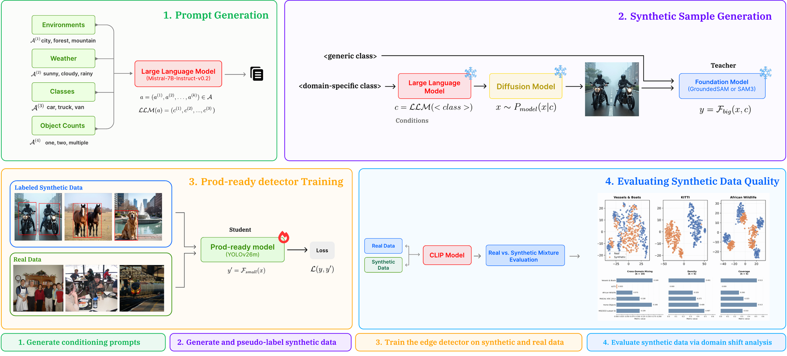
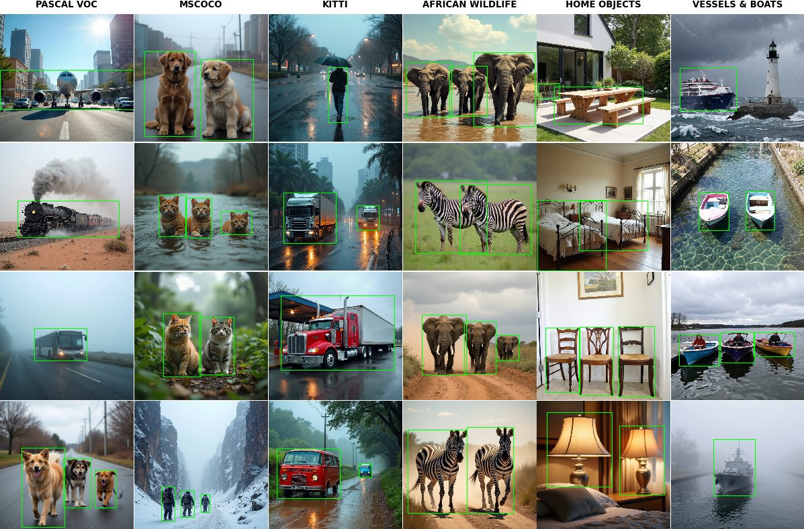
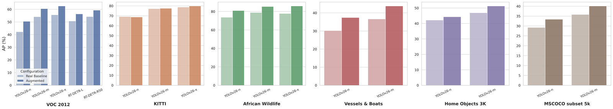

# Controllable Synthetic Data Generation for Data-Efficient Object Detection in Real-World Domains

[](https://josericardopenase.github.io/training-free-synthetic-data-object-detection/)
[](https://github.com/josericardopenase/training-free-synthetic-data-object-detection)
[](#citation)

**Training-free** synthesis of pseudo-labeled detection data: structured LLM prompts → FLUX images → Grounded SAM boxes → detector training on real + synthetic mixtures.

**[Project page](https://josericardopenase.github.io/training-free-synthetic-data-object-detection/)** · **Code** (this repo) · Paper PDF *(link after arXiv)*

<p align="center">
  
</p>

<p align="center">
  <em>Jose R. Peña-Seco<sup>1</sup>, Jonay Suárez-Ramírez<sup>2</sup>, Adrian Penate-Sanchez<sup>1</sup>, Nelson Monzón<sup>1</sup></em><br/>
  <sup>1</sup>ULPGC &nbsp;·&nbsp; <sup>2</sup>QAISC
</p>

---

## Why this exists

Object detectors need instance-level boxes. In specialized domains those labels are expensive, and rare conditions (weather, viewpoints, object counts) are hard to capture. Classical augmentation only remixes what you already have.

This work treats synthetic data as a **controllable, automatic** resource: specify *what* to generate, synthesize images with a frozen diffusion model, and pseudo-label them with an open-vocabulary grounder — **no fine-tuning** of the generator or the annotator.

## Method (short)

| Stage | What we do |
|-------|------------|
| 1. Prompts | Mistral-7B-Instruct expands class × environment × weather × quantity into captions |
| 2. Images | FLUX synthesizes samples from those captions |
| 3. Labels | Grounded SAM annotates with a **one-category-per-image** strategy (reduces false positives; maps domain-specific names to generic grounding prompts) |
| 4. Train | YOLO26 / RT-DETR trained from scratch on real + synthetic mixtures |

We also analyze the **synthetic-to-real gap** in CLIP space (t-SNE + neighborhood mixing / density / coverage) to interpret when augmentation helps.

<p align="center">
  
</p>

## Results

Evaluated on **six** benchmarks: PASCAL VOC 2012, MS-COCO subset, KITTI, African Wildlife, Home Objects 3K, and industrial **Vessels & Boats**.

| Setting | Main outcome |
|---------|----------------|
| VOC full real + 16k synth | up to **+9.0 pp AP50** (YOLO26-n) |
| VOC 1k real + 16k synth | up to **+35.4 pp AP50** |
| Vessels & Boats | ~**1/3** of real images + synth **matches full-real AP** |
| Domain dependence | Strong on diverse / maritime scenes; limited / negative transfer on viewpoint-locked KITTI (full-data nano) |
| Overall | Gains in **31 / 32** evaluated configurations |

<p align="center">
  
</p>

More tables, scaling curves, and domain-gap figures: **[project page](https://josericardopenase.github.io/training-free-synthetic-data-object-detection/)**.

## Repository

```text
docs/                      Project page (GitHub Pages)
prompt_generation.ipynb    Structured LLM prompts
diffusion_generation.ipynb FLUX image synthesis
groundedsam_labeling.ipynb Automatic boxes (Grounded SAM)
training_scripts/          YOLO / RT-DETR training & eval notebooks
domain_shift_*.ipynb       Real–synthetic distribution analysis
charts.ipynb               Result plots
requirements.txt           Python dependencies
```

## Setup

```bash
git clone https://github.com/josericardopenase/training-free-synthetic-data-object-detection.git
cd training-free-synthetic-data-object-detection

# Option A
uv sync

# Option B
python -m venv .venv && source .venv/bin/activate
pip install -r requirements.txt
```

GPU recommended for FLUX generation and detector training (see paper for hardware notes).

## Usage

End-to-end flow (notebooks):

1. `prompt_generation.ipynb` — build controllable prompts  
2. `diffusion_generation.ipynb` — generate images with FLUX  
3. `groundedsam_labeling.ipynb` — pseudo-label with one-category-per-image  
4. `training_scripts/yolo_training.ipynb` — train on real + synthetic mixtures  
5. `domain_shift_analysis*.ipynb` — optional CLIP / t-SNE diagnostics  

Preview the project page locally:

```bash
cd docs && python3 -m http.server 8000
# open http://localhost:8000
```

## Citation

```bibtex
@article{penaseco2026controllable,
  title={Controllable Synthetic Data Generation for Data-Efficient Object Detection in Real-World Domains},
  author={Pe{\~n}a-Seco, Jose R. and Su{\'a}rez-Ram{\'i}rez, Jonay and Penate-Sanchez, Adrian and Monz{\'o}n, Nelson},
  journal={Preprint},
  year={2026}
}
```

## Acknowledgments

Supported by the Cabildo de Gran Canaria (Resolution 45/2021) and Qualitas Artificial Intelligence and Science (QAISC). The Vessels & Boats dataset was provided by QAISC under research contract C2024/54 with the University of Las Palmas de Gran Canaria.
